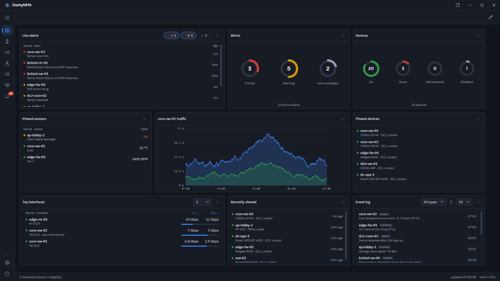
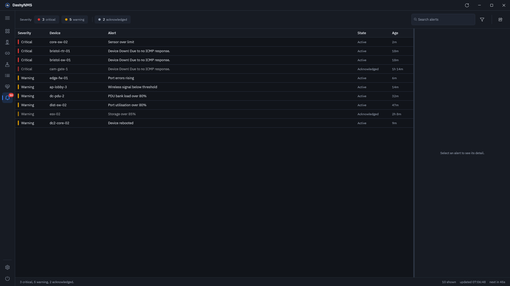
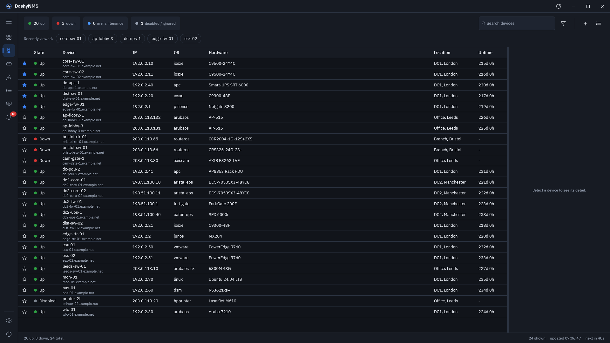
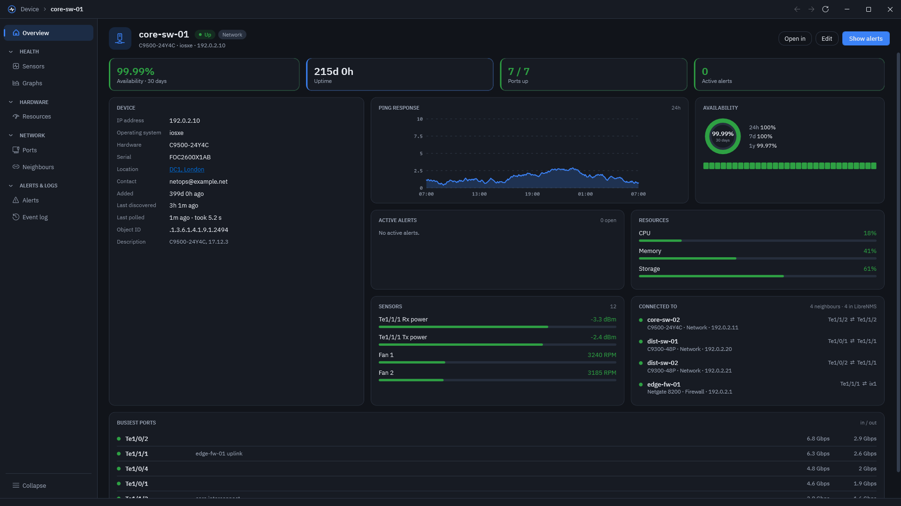
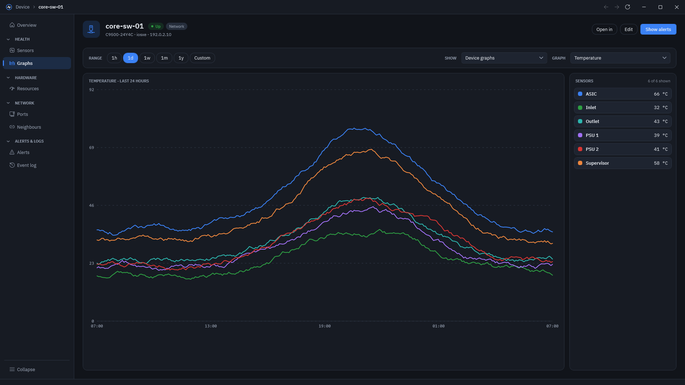
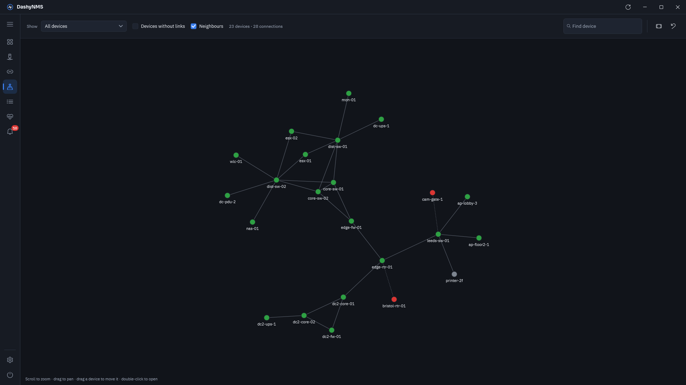
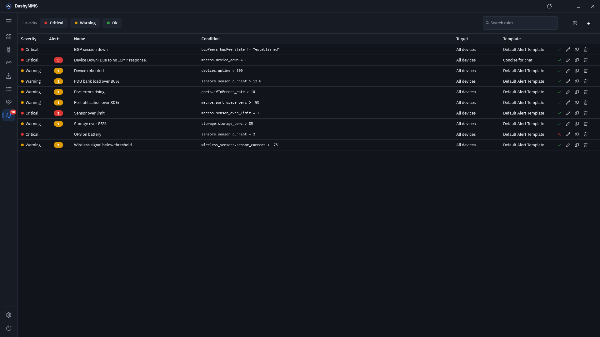
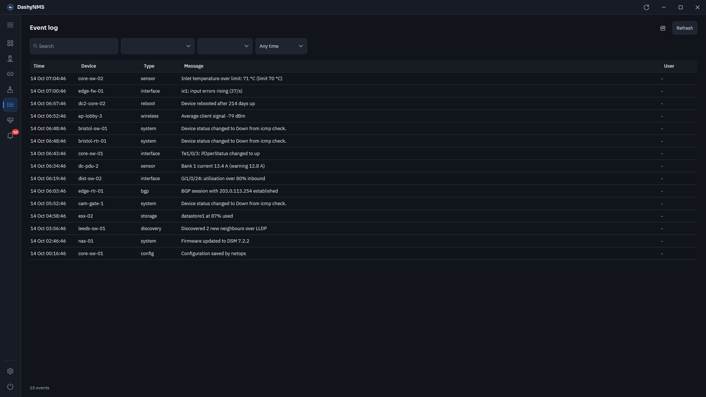
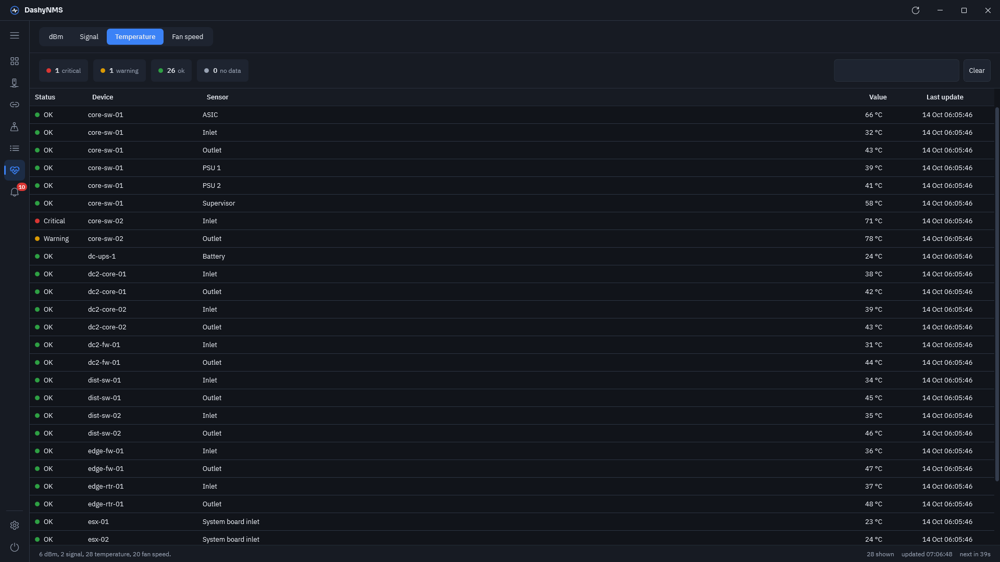

  

<h1 align="center">DashyNMS</h1>

  <strong>Your LibreNMS network, right on your desktop.</strong> 
  Version 2.0 development targets Windows, macOS and Linux.

  <a href="https://dashynms.pckp.net/desktop/">Website</a> ·
  <a href="https://github.com/DashyNMS/desktop/releases/latest">Download</a> ·
  <a href="https://dashynms.pckp.net/desktop/privacy/">Privacy</a>

---

Keep an eye on your network without living in a browser tab. Sign in once and DashyNMS watches your LibreNMS server from the notification area, tells you the moment something changes, and gives you a full desktop app for devices, alerts, rules, maps and graphs when you need to dig in.

It works with any [LibreNMS](https://www.librenms.org/) server, and has a companion app for your phone, [DashyNMS Mobile](https://github.com/DashyNMS/mobile).

No server to hand? Choose **Try the demo** on the sign-in window to look around an example network first.

## What you can do

**Know when something's wrong**
A desktop notification when an alert fires or clears, with Acknowledge right on it. Choose which alerts notify you: leave out the noisy rules, or only hear about the ones that matter, on every device or just one. Choose how insistent each severity is, and set quiet hours. The tray icon turns amber or red with the number of open alerts, and a click on it shows the worst of them without opening the app.

**See what matters first**
Build your own dashboard from widgets: open alerts, device status, sensor readings, graphs, the event log, Graylog messages, pinned and recently viewed devices. Spotlight an event log or Graylog card on some devices, a group or a location to see only their entries. Drag and resize the widgets however you like, or start from a ready-made one.

**Get to the bottom of it**
Open any alert to see exactly why it fired and what its rule is looking for. Acknowledge it with a note so your team knows you're on it, and filter, search or export the list.

**Every device, in detail**
A sortable, filterable list of your whole network. Open a device to see its status, hardware, ports, sensors, neighbours, VLANs, MAC and ARP tables, graphs and event log. Pin the ones you check most so they're always at the top.

**Take action**
Add devices one at a time or in bulk, put them into maintenance, ask LibreNMS to check them again, or connect straight to them over SSH, Telnet or the web.

**Manage your alerting**
A full alert rule editor, as on the LibreNMS website: build conditions, import from another rule or an SQL query, and choose which devices, groups and locations a rule covers. Edit alert templates and see which rules use each one.

**Every log in one place**
The Logs tab brings LibreNMS's event log and alert log for your whole network together with Graylog. Search and filter them, go back up to 1,000 entries, and open any entry's device. Copy or save CSV from Graylog and each device's Event log and Alert history. Exports include the current Graylog page or the loaded log entries, with the current search and row sort order applied.

**See how it all connects**
Network and geographical maps, maps of your own, and a view of each device's neighbours. Health brings temperature, fan, optical power and signal readings from across your network into one place.

**More when you need it**
Connect Graylog to search its messages under Logs and alongside each device, and Unimus to see each device's configuration backups. If your server has a backup address, DashyNMS switches to it when the main one stops answering.

**At home on your desktop**
Dark or light, with your choice of accent colour. It checks for new versions and offers the update available for your platform.

<table>
  <tr>
    <td></td>
    <td></td>
  </tr>
  <tr>
    <td></td>
    <td></td>
  </tr>
  <tr>
    <td></td>
    <td></td>
  </tr>
  <tr>
    <td></td>
    <td></td>
  </tr>
</table>

## Private by design

DashyNMS talks to your own LibreNMS server, and to Graylog and Unimus only if you set them up. There's no DashyNMS account to create. Optional error reports and basic launch statistics stay off until you choose to share them. Your API token never leaves your computer except to go to your server, or to your phone if you show it the sign-in QR code. Read the full [privacy notes](PRIVACY.md).

## Get the app

The current release, 1.1, is for Windows. Download the installer from the [latest release](https://github.com/DashyNMS/desktop/releases/latest) and run it. It installs just for your Windows account, so you don't need admin rights.

Version 2.0 runs on Windows, macOS and Linux, and you can try it now from the [preview releases](https://github.com/DashyNMS/desktop/releases). The [user guide](docs/guide/README.md) explains how to install, update and remove it on each system.

## What you need

- Windows 10 (version 1809 or later) or Windows 11, macOS 13 or later, or Linux with a desktop. macOS and Linux need version 2.0.
- A LibreNMS server you can reach from your computer, with its API turned on, and an account on it with API access.

Open DashyNMS, enter your server's address and choose **Sign in with LibreNMS**. You sign in on your server's own page, however it signs people in, and DashyNMS creates its API token for you. That's it. This needs LibreNMS 26.4 or later and an https address.

You can paste an API token instead: in LibreNMS, open the settings menu, then **API → API Tokens**, and create one. If you don't have access, your LibreNMS administrator can make one for you in a couple of minutes.

To sign DashyNMS Mobile in to the same server, open **Settings → Server**, choose **Show** under **Sign in DashyNMS Mobile** and scan the code with your phone's camera. The phone asks before it signs in. It shares this computer's token, so a separate token for the phone is the better choice if you'd rather revoke them separately.

On Windows and macOS, closing the window keeps DashyNMS running in the notification area or menu bar, so it can still tell you when something needs attention. [Getting started](docs/guide/getting-started.md) walks through the first sign-in.

## Help and feedback

- Found a bug or have an idea? [Open an issue](https://github.com/DashyNMS/desktop/issues). Planned work is tracked there too, under the [milestones](https://github.com/DashyNMS/desktop/milestones).

---

DashyNMS isn't affiliated with LibreNMS or Graylog. LibreNMS and Graylog are trademarks of their respective owners. 
The source is published for reference and security review only. All rights reserved; see [LICENSE](LICENSE). 
Found a security problem? See [SECURITY.md](SECURITY.md). Technical notes are in the [developer guide](docs/DEVELOPMENT.md).
