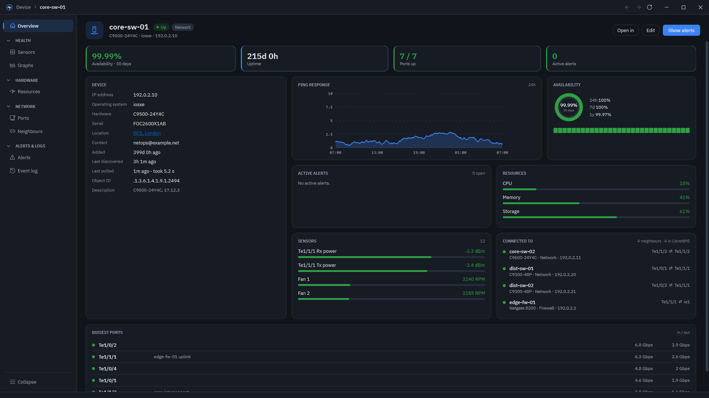
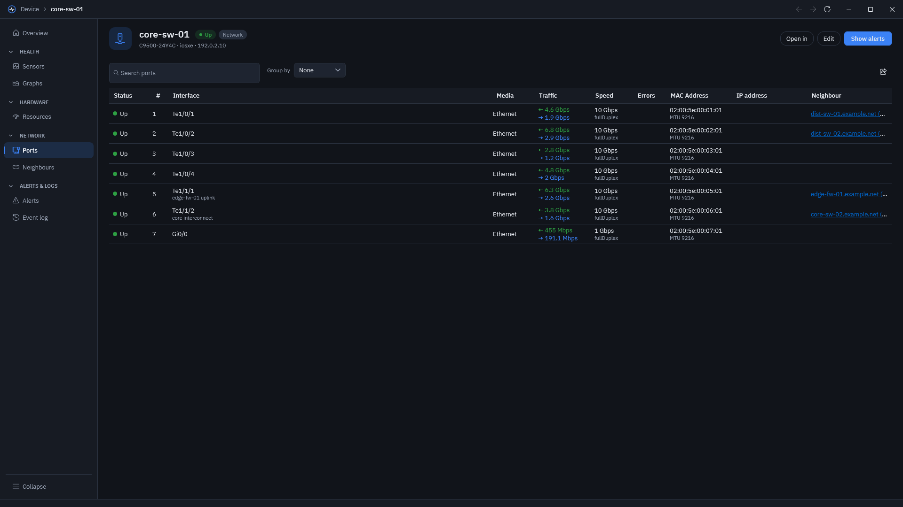
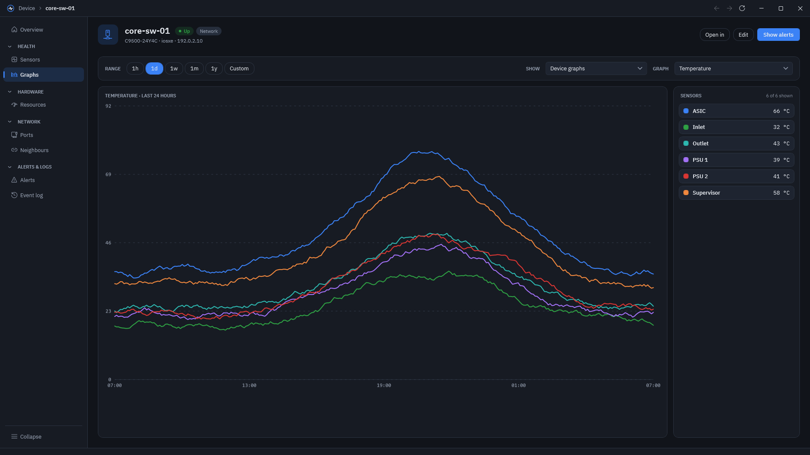

# Investigate a device

Start with its status, then compare the measurements and events around the time of the problem.

## Find and pin a device

1. Open **Devices** and search for the device.
2. Use the list's filters to narrow a large network, and click a column heading to sort it.
3. Open the device to see its details.
4. To keep it nearby, select it in the Devices list and use the right-click pin action.

Pinned devices appear at the top of the list and can appear in a [dashboard widget](dashboard.md). To remove a pin, use the unpin action in the same menu.

## Check a busy or failing interface

1. Open the device's **Ports** view.
2. Find the interface by its name or description.
3. Compare its status and traffic with what you expect for that link.
4. Open the relevant graphs and choose a time range covering the incident.
5. Compare the graph with the device's Event log and Alert history.

### See ports as a table or cards

The Ports view shows a table by default, with every detail in columns you can sort. To scan a long list of ports at a glance, open **Settings → Devices** and set **Ports layout** to **Cards**. An open device switches straight away.

Each card shows the port's name and description, its status and speed, traffic and errors in and out, and its VLANs. The coloured edge and dot match the table's Status column, which sorts and groups by the same status:

- **Up · errors**, **Down · errors** or **Errors** in red: errors were counted in either direction, on a port that is up, down, or in another state such as testing. The side with errors is red too.
- **Down** in amber: the port is enabled, its link is down and no errors were counted.
- **Up** in green: the link is up with no errors.
- **Disabled**, **Not monitored** or **Unknown** in grey: someone shut the port down, LibreNMS doesn't poll it or ignores it, or its state isn't known. **Up · readings unavailable** is also grey, because without error readings the port can't be called healthy.

A reading LibreNMS hasn't sent says **Unavailable** rather than zero, and traffic is not shown while a port is not up. VLANs come from the memberships LibreNMS reports for the device. If it reports none, a port's own VLAN is shown as its access/native VLAN. If it reports them but not for this port, the card says **Not reported**.

Search, **Group by**, export and the graphs under the list work the same with cards. Group by **VLAN** follows the VLANs each card shows: a **Trunk** group first for ports carrying more than one VLAN, then one group per VLAN in number order for ports carrying only that VLAN, and **No VLAN** last for ports with none to show. Select a card, or move to it with Tab and press Enter or Space, to show that port's graphs.

A graph shows the history collected by LibreNMS. An empty graph can mean the device or measurement is new, or that LibreNMS has no samples for the selected period.

## Compare sensor history

1. Open the device's graphs and choose the sensor or graph type you need.
2. Set a time range that includes both normal operation and the problem.
3. Compare readings across the sensors, rather than judging one current value alone.

Use [Health](maps-and-health.md#check-readings-across-the-network) when you need to compare sensors on several devices.

## Follow the connection to another device

Open the device's neighbours to see the links LibreNMS knows about. Use the related device to continue the investigation, or switch to the network map for a wider view. Missing neighbours usually need checking in LibreNMS discovery and the devices' neighbour protocols.

## Open the device in another tool

Choose **Open in** and select **Web (HTTP)**, **Web (HTTPS)**, **SSH** or **Telnet**. DashyNMS hands the address to an external application. SSH and Telnet need a suitable handler installed on your computer.

For planned work, [schedule maintenance](maintenance.md) before making changes to the device.
