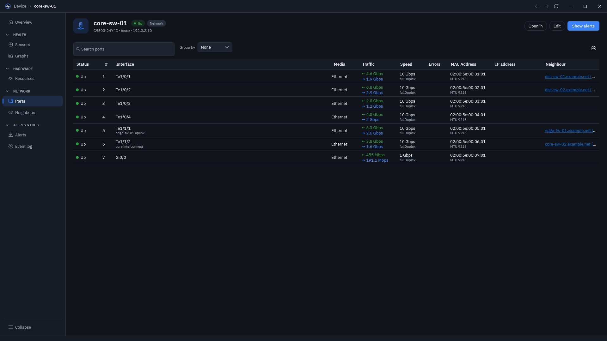

# Investigate a device

Start with its status, then compare the measurements and events around the time of the problem.

## Find and pin a device

1. Open **Devices** and search for the device.
2. Use the list's filters to narrow a large network, and click a column heading to sort it.
3. Open the device to see its details.
4. To keep it nearby, select it in the Devices list and use the right-click pin action.

Pinned devices appear at the top of the list and can appear in a [dashboard widget](dashboard.md). To remove a pin, use the unpin action in the same menu.

## Check a busy or failing interface

1. Open the device's **Ports** view.
2. Find the interface by its name or description.
3. Compare its status and traffic with what you expect for that link.
4. Open the relevant graphs and choose a time range covering the incident.
5. Compare the graph with the device's Event log and Alert history.

A graph shows the history collected by LibreNMS. An empty graph can mean the device or measurement is new, or that LibreNMS has no samples for the selected period.

## Compare sensor history

1. Open the device's graphs and choose the sensor or graph type you need.
2. Set a time range that includes both normal operation and the problem.
3. Compare readings across the sensors, rather than judging one current value alone.

Use [Health](maps-and-health.md#check-readings-across-the-network) when you need to compare sensors on several devices.

## Follow the connection to another device

Open the device's neighbours to see the links LibreNMS knows about. Use the related device to continue the investigation, or switch to the network map for a wider view. Missing neighbours usually need checking in LibreNMS discovery and the devices' neighbour protocols.

## Open the device in another tool

Choose **Open in** and select **Web (HTTP)**, **Web (HTTPS)**, **SSH** or **Telnet**. DashyNMS hands the address to an external application. SSH and Telnet need a suitable handler installed on your computer.

For planned work, [schedule maintenance](maintenance.md) before making changes to the device.
