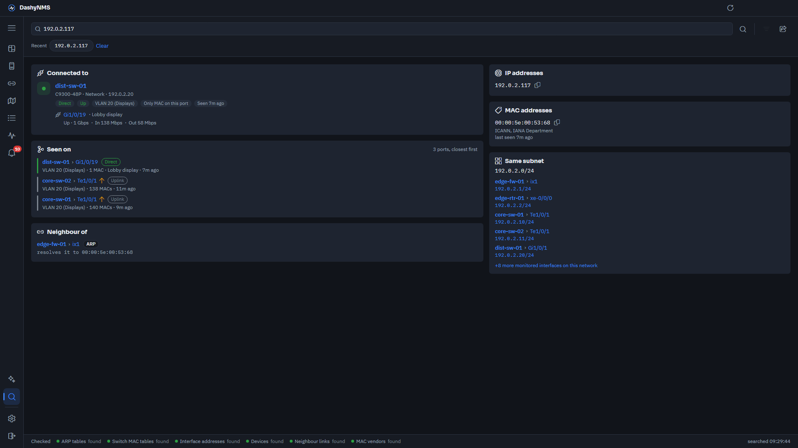

# Find anything with Network Search

Use Network Search when you have an address, a MAC address or a name and need to know where it is on the network: which switch port it plugs into, which VLAN it's on, and which router knows it.

## Search

1. Open **Network Search** from the search icon under Intelligence in the sidebar, or press **Ctrl+Shift+F** (**Cmd+Shift+F** on macOS) from any page.
2. Type or paste what you're looking for, then press **Enter**:
   - an IPv4 or IPv6 address, such as `192.0.2.117`;
   - a network, such as `192.0.2.0/24`;
   - a MAC address in any common format: `00:00:5e:00:53:68`, `00-00-5E-00-53-68`, `0000.5e00.5368` or `00005e005368`;
   - a device name;
   - several addresses, MAC addresses or hostnames pasted at once.
3. To see a list of the addresses your routers know, search with the box empty.

Text copied from logs or configuration usually works as it is. DashyNMS removes quotes, brackets, `ip=` and `mac:` labels, and a port number after an address.

Recent searches appear under the box. Select one to search again, or **Clear** to forget them.

## Read a result

**Connected to** comes first, laid out like the neighbour cards in device details.

- **An address LibreNMS doesn't monitor** shows the switch and port it plugs into. If it's on more than one access port, such as a server with two links, every port is shown. Each one shows:
  - the switch's state;
  - whether the address is the **Direct** (only) MAC on the port, **Shared** with others, or on a port whose MAC count couldn't be read;
  - its VLAN, how recently it was seen, and the port's status and traffic.
- **A monitored device**, such as a switch or server, shows every neighbour it's linked to, uplinks included, as device details does. Select **+N more connections** to see them all.

When LibreNMS can't name the link, Connected to falls back to where the MAC address was learned and says why. This happens for a device with no discovered neighbours, or an address seen only on links between switches. In the second case it shows the closest port, marked **Uplink**.

Neighbours LibreNMS doesn't monitor are shown in full, but can't be opened.

The cards below show:

- **Seen on**: every switch port that learned the address, closest first. Uplinks are marked with an arrow, and a sighting more than a day older than the newest is dimmed as stale.
- **IP addresses** and **MAC addresses**: copy any value with its button. The MAC's maker comes from LibreNMS.
- **Same subnet**: the network the address belongs to, with its gateway first. Select **+N more** to list every monitored interface on it.
- **Neighbour of**: the routers whose ARP tables hold the address.

A search that matches a monitored device opens with a summary of that device. Select it to open device details. Every switch, port and interface opens its own view too.

**Conflicts** appears when one address answers from more than one MAC address, or one MAC address is on more than one access port at the same time. These often mean a duplicate address, a failover pair, a loop or a host that moved.

## Lists and filters

A network, an empty search or a pasted list can match many addresses. They appear as a list. Sort by any column, type in **Filter this page**, or select **Filter** to narrow the list by:

- **Source**: where the address was found (router ARP tables, interface addresses, devices);
- **Seen by**: the router that knows it;
- **Monitored**: whether LibreNMS monitors it.

Select an address to see where it's connected. Use **Next** and **Previous** to page through long lists. Select the export button to copy the results or save them as CSV.

## What was checked

The status bar lists the sources DashyNMS asked and what each said: found, nothing, not checked, no permission, unavailable or failed. Hover over one for details.

If your LibreNMS account can't read switch MAC tables, or your server doesn't offer a source, Network Search says so rather than reporting the address as missing. Only when every source answered and none knew the address does it say the address isn't on the network.

LibreNMS doesn't share IPv6 neighbour tables through its API, so IPv6 addresses are found only when a monitored device or interface uses them.

## Choose how MAC addresses look

Open **Settings**, choose **Devices**, and pick a format under **MAC addresses**. Network Search uses it on screen and when you copy or export results. Searches accept any format whichever you choose.
